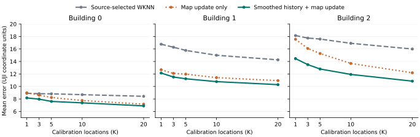

# UJI 少标定定位重构

默认入口是 [refi.fit_map](../../refi.py)。本轮把初稿视为研究方向，保留了一个可以独立验证的想法：跨楼层历史指纹适合提供平滑的空间轮廓，目标楼层采到的扫描可以修正这个轮廓。旧 GP 作为参照实现保留。部署不需要读取旧训练缓存、神经网络或推断采样器。

## 哪些目标达到了

| 问题 | 固定官方查询 | 换手机复核 |
|---|---|---|
| 多加标定有没有用 | 三栋楼的均值都逐档下降。楼层相邻预算有 43/52 次下降，6/13 层每一步都下降 | 楼均相邻预算 11/12 次下降。B1 的 K=1→3 从 11.791 升至 11.903 |
| 与同信息 WKNN 比较 | 胜过源楼选出的强 WKNN 共 15/15 个建筑×K、64/65 个楼层×K、608/650 个抽样事件 | 对应为 15/15、55/65、514/650 |
| 从历史任务学习的增量 | 三折直接优化标定后的定位 MDE，都学到对局部对比作相同程度的平滑。双参数与固定半平滑的预测相同 | 固定半平滑 9.513，扩大搜索范围后源楼选参 9.551，原始历史图 10.671 |

**当前决策**：把历史半平滑、现场残差传播、删失信号匹配留在部署入口。跨环境训练确实找出了有用的历史变换，但尚无实验证明根据内容学习不同的变换能超过这条固定规则。三个建筑均曾用于项目开发，这里报告的是 UJI 内的开发结论。



## 主模型到底做什么

同一楼层同一平面坐标的重复扫描先平均，多个历史源在同一坐标各贡献一个原型。建图时将未检出填为 −110，保持整扫描向量；匹配时对未检出单独计分。设历史原型为 $M$，候选点是历史坐标和真实标定坐标。

1. 对历史图做一次局部平均。$P_{10}$ 是历史坐标之间逐行归一化的高斯权重，包含当前位置。令 $M_0=(M+P_{10}M)/2$。一个只在个别历史位置出现的尖峰会减弱，邻域内共同出现的强弱轮廓保留。
2. 在每个目标标定位置读出 $M_0$ 的预期扫描，读值沿用仓库的三近点反距离插值。用真实扫描减去预期，得到每个 AP 的现场残差 $E$。在旧原型位置 $X$ 更新整张图：

   $$M_S(X)=M_0(X)+R_{40}(X,S)\,[R_{40}(S,S)+I]^{-1}E.$$

   $R_{40}$ 是固定的单位幅 RBF 核。结果截断到 [−110, 0]，然后追加现场的实测原型。两处标定的关系进入同一个线性方程组，K 增加时按当前全部 S 重新求解。
3. 用仓库已有的 Tobit 型匹配对每个候选坐标打分，检出的 AP 比 RSS，未检出的 AP 计算删失项，输出归一化权重的坐标均值。匹配尺度为 12 dB，阈值为 −85 dBm。

10 和 40 均为 **UJI 原投影坐标单位**，分别控制历史图的空间平滑和标定修正的传播。这里更新的是填充后的经验指纹图，默认模型不输出完整随机场协方差。原型构造、锚点插值、核修正和匹配均复用了仓库的 [TPM/SCM-T 适配实现](../../external_baselines/tpm_adapter.py)。

## K 曲线与真实例外

每格为官方查询位置等权的 MDE，括号内为同样 H、S、Q 的强 WKNN。10 次抽样等权，各楼层等权。跨楼汇总时三栋建筑再等权。

| 目标 | K=1 | K=3 | K=5 | K=10 | K=20 |
|---|---:|---:|---:|---:|---:|
| B0 | 8.17 (8.91) | 7.97 (8.84) | 7.61 (8.83) | 7.38 (8.69) | 6.89 (8.43) |
| B1 | 12.15 (16.77) | 11.52 (16.29) | 11.23 (15.77) | 10.77 (15.00) | 10.29 (14.27) |
| B2 | 14.46 (18.15) | 13.50 (17.75) | 12.80 (17.59) | 11.93 (16.91) | 10.85 (16.00) |
| 三楼等权 | 11.59 (14.61) | 10.99 (14.29) | 10.55 (14.06) | 10.03 (13.53) | 9.35 (12.90) |

强 WKNN 在源楼同时选择原始扫描或“楼层×位置”均值原型，以及 1、3、7、15 个邻居。三个留楼折都选择原型，邻居数依次为 3、7、3。固定原型 3-WKNN 也完整报告，其整体 MDE 为 13.291，比源端选参的 13.879 更强。主模型的 10.502 对两者分别降低 21.0% 和 24.3%。将相同的已修正地图也提供给 WKNN，比较见下节。

官方查询中，格均唯一输给强 WKNN 的是 **B0F3、K=1，8.576 对 7.961**。另一个值得追踪的楼层是 B1F1，K=1 至 20 从 8.958 变为 9.478。官方数据有 360/520 个逐抽样的相邻预算差值下降。换手机时，B1F2 的五个预算均落后于强 WKNN。楼均曲线并不能代替这些场景下的实测结果。

## 同一张图的交换实验

整条流程胜过传统 WKNN 无法回答收益来自哪里。下表的四组共用半平滑后的 H 坐标、完全相同的 S 实测候选、AP 和 Q。左列只追加 S，右列还把锚点残差传播给原有 H 原型。WKNN 在两个条件下都由源楼选出三个邻居。数值按建筑、楼层、预算和抽样等权。

| 位置读出 | 只追加实测 S | 同时修正历史原型 |
|---|---:|---:|
| WKNN | 13.153 | 12.651 |
| Tobit 型分数的坐标期望 | 12.340 | **10.502** |

固定概率读出，现场修正把误差再降 1.838。把完全相同的已修正地图交给两种读出，概率读出再降 2.149，15/15 个建筑预算均值较低。读出切换同时改变了未检出信息处理和候选坐标的加权方式，实验无法把这 2.149 单独归因于删失项。

另一次机制检验在原始历史图上把 S 的真实位置和所有候选固定。K=20 时，把每个残差传播到它应在的位置得 10.098，只做全局偏移得 12.138，将残差在标定位置之间循环错配得 13.130。这说明标定不仅贡献新候选坐标，测到的偏差位于哪里也会改变定位。

## 哪一层学习值得留下

初稿中的“局部变换”可以在这条短路径上直接学。把每个历史原型减去其邻域均值，得到局部对比 $D=M-P_{10}M$。令 $M_\theta=M+g_\theta D$，只学弱信号与强信号两端的增益，中间按历史局部平均信号强度插值。每次在另一栋楼的模拟任务中先变换 H、再用 S 更新、再定位 Q，**直接按更新后的坐标 MDE 拟合**。因此可以在读出、标定和素材完全相同的条件下，单独比较学到的规则。

| 已实施的选择 | 官方整体 MDE | 决策依据 |
|---|---:|---|
| 原始 H 加相同 S 更新 | 11.645 | 变换前基座 |
| 固定锐化 / 固定半平滑 | 13.753 / **10.502** | 减弱历史尖峰有收益，锐化恶化 |
| 学一个全局对比系数 / 按内容学两个系数 | 10.502 / 10.502 | 三折都选 −0.5，弱、强系数没有分开 |
| 扩大平滑强度与邻域的源端选择 | 10.541 | 两折复选半平滑/10，B0 折选半平滑/20，未带来额外收益 |
| 全平滑，邻域 10 / 20 | 11.230 / 11.779 | 过度平滑会丢掉有用空间差异 |

在变换前的基座上还做了几项替换，作为停止依据保存在实验目录。单学 **S 的传播半径** 三折均复选固定的 40。根据源楼重复测量学习残差协方差，源端二阶矩拟合改善，官方 15/15 个建筑预算组合退化。学现场未检出残差折扣后为 11.743，学观测分布后为 12.238，均高于对应的固定基座 11.645。直接在历史逆向定位结果上搬移坐标残差，两折回到普通 WKNN，余下一折在官方查询上退化。这些替换都可以单独复跑。

## 为什么重新评测旧 GP

在 B0F1、B1F1、B2F2 用每层三个预定抽样重建了历史 GP 对照。45 个预算事件均使用全体合规 AP、固定 H 候选网格、原仓的 Gaussian-VI 后端和同一批官方查询。经 S 拟合共享来源权重的 GP 在 41/45 个事件优于原始 3-WKNN，在 35/45 个事件优于源选强 WKNN。B2F2 的三抽样均值从 K=1 的 18.361 降至 K=20 的 12.907。后续研究若要主张历史来源可信度毫无价值，这个对照不支持该主张。

B1F1 的拟合权重 GP 从 K=1 到 3 在三个抽样上都恶化。进一步将来源权重固定成等权，按查询距新增两处 S 的距离分组。最近四分之一查询位置的平均误差分别增加 **6.81、4.60、2.45**；最远四分之一的变化为 −0.08、−0.46、约 0。两个抽样的截距尺度也保持不变。在这两个抽样上，新增观测经后验更新和坐标读出，已经足以造成局部恶化。设备、时间、楼层结构哪个造成了修正方向错误，现有数据无法分离。旧 B0/B2 内部查询的原始 WKNN 复查另发现，完全等距的两个第三近邻足以把 B2 K=5 的均值从 14.030 改到 14.372，新 WKNN 统一按原始行号解并列。

历史 GP 的源参数重新构建，B0 目标使用 B1 源参数，B1/B2 使用 B0 源参数。部分 B1 空间参数使用项目记录中的三位小数。本轮不是早期冻结 PMC 结果的逐值复现。三个抽样的全部预测、使用的参数及查询行号见证据包。

## 数据、统计和复现

- 原始 UJIIndoorLoc 共 19,937 条训练扫描、1,111 条官方验证扫描。H 为同楼其他楼层的全部训练扫描，S 为目标层按不同平面坐标均匀抽样的嵌套前缀，每位置一条训练扫描。所有 13 个目标层各有 10 次抽样，K 为 1、3、5、10、20。官方查询固定为目标层全部验证扫描，共 1,074 个“楼层×位置”。主评估保留全部官方查询，包括与目标训练集坐标完全相同的 12 条验证扫描。数据归属和原始许可见 [UCI 数据页](https://archive.ics.uci.edu/dataset/310/ujiindoorloc)。
- 同一预算仅可见 H 或当前 S 检出过的 AP。源楼训练另抽 24 个不与 S 重合的查询位置，每处一条扫描。每个外折只用另外两栋楼的训练文件，固定参数后才评估本栋。建筑 ID 和楼层标签用于构造任务，查询标签只供评分。强 WKNN 与模型得到相同部署信息。源楼的选择集和设备压力任务都可由行号重建。
- 手机压力测试另用训练文件。每个目标层按预定的可行性和位置数量选一部手机，固定 12 个查询位置。该手机的扫描从部署时所有 H/S 排除，S 同时排除这 12 个坐标。13 层均可用，共 8 个查询手机 ID。此为设备与位置均隔离的附加划分，仍是 UJI 三栋楼。
- 官方对坐标先平均其重复扫描的欧氏误差，再等权平均坐标、抽样、楼层和建筑；每个 K 单独展示。统计在每层内成对重抽 10 个标定集，整条 K 曲线随抽样共同移动。5,000 次分层重抽给出每组对比 15 格的一侧同时 95% 上界。相对源选 WKNN 的 15 格上界均低于零，相对“相同修正图上的 WKNN”为 12/15；楼均相邻 K 降幅有 5/12 的同时上界低于零。这些区间只描述**给定楼层和固定查询时**的标定抽样波动，未校正开发期间选模型，也不能作为新建筑的泛化区间。

从仓库根目录运行。轻量全套使用 Python 3.12、NumPy 2.3.5、SciPy 1.17.0、pandas 2.2.3 和 Matplotlib。先从 UCI 解压两个 CSV，然后运行：

```bash
bash research/uji_core/reproduce.sh /path/to/UJIndoorLoc /tmp/uji-core-results
```

附带的 [证据包](evidence.zip) 含 48 个 CSV/JSON，包括抽样行号、源端配置、成对事件、部署入口核对、手机测试和 GP 逐查询输出。归档中的 `results/` 可解压到本目录后单独运行汇总。可直接查看 [楼均结果](results/building_means.csv)、[逐层结果](results/floor_means.csv) 和 [配对区间](results/paired_intervals.csv)。`inverse_queries.csv.gz` 体积较大，由复跑生成。

旧 GP 另需 CPU PyTorch 2.8，按下列方式执行；建议 BLAS 单线程。复用上一步产生的对照表。

```bash
d=/path/to/UJIndoorLoc
r=/tmp/uji-core-results
for b in 0 1 2; do
  python -m research.uji_core.field_control "$d" research/uji_core/field_parameters.json "$r/field_b$b.json" --building "$b"
  for s in 1 2; do
    python -m research.uji_core.field_control "$d" research/uji_core/field_parameters.json "$r/field_b${b}_s$s.json" --building "$b" --seed "$s" --budgets 1 3 5 10 20
  done
done
python -m research.uji_core.field_diagnostic "$d" "$r"
```

## 研究定位与下一步

核修正目标函数已有迁移回归先例，Wi-Fi 领域也已有用新观测更新指纹图的研究；设备差异会改变检出概率，这为换手机压力测试提供了独立动机。因此，固定核平滑、残差更新或缺失信号计分都不宜单列为算法创新。[Du 等，NeurIPS 2017](https://proceedings.neurips.cc/paper_files/paper/2017/file/352fe25daf686bdb4edca223c921acea-Paper.pdf) · [He 等，IEEE TMC 2017](https://doi.org/10.1109/TMC.2016.2608946) · [Park 等，IEEE INFOCOM 2011](https://people.csail.mit.edu/teller/pubs/ParkEtAl_INFOCOM2011.pdf)

下一轮若继续做学习，固定本分支的默认曲线和 2×2 对照。聚焦 B1F1 的一个具体问题：新增标定揭示的是可重复的局部变化，还是单次扫描偏差？用源建筑同位置的重复实测构造两次独立观测，第一次下判断、第二次验证偏差方向是否可重复；参数依据源端标定后的定位损失选择，然后在未用于设计的采集期或建筑与固定半平滑基座比较。只有这项学习能同时改善定位且经受设备变化，才值得放回默认路径。UJI 每个预算仍按 R=1 比较，额外重复只在源训练与机制验证中使用。
