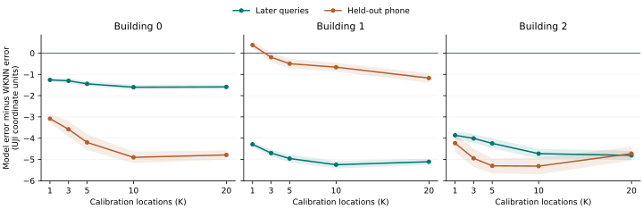

# 三个目标的第二轮检验

本轮只把一项改动放进定位入口。知道楼层关系时，按照旧楼层和目标的距离加权建图。脚本中学习出来却不能超过简单规则的结构留在复算包。研究日志使用通俗语言记录了每次取舍。[Notion 实验记录](https://app.notion.com/p/40b217e091ae81ccb37dff0f954a1a8c)

## 先看同一批人的手机，究竟定位得怎样

H 是同楼其他层的实测记录。S 是目标层的 1、3、5、10 或 20 个位置，每处只拿一条扫描。每层做 10 次嵌套抽样，楼层和建筑等权。官方查询来自后续采集；另做一次换手机实验，将查询手机从整栋楼部署时的 H 和 S 中移除。每个协议 650 个事件，共用上一轮的行号。距离均为 UJI 原投影单位。

| 测试与方法 | K=1 | K=3 | K=5 | K=10 | K=20 |
|---|---:|---:|---:|---:|---:|
| 后期官方查询，本轮楼层加权基座 | 10.745 | 10.327 | 10.125 | 9.780 | 9.265 |
| 后期官方查询，楼层感知 WKNN | 13.922 | 13.776 | 13.717 | 13.597 | 13.105 |
| 留手机查询，本轮楼层加权基座 | 10.270 | 9.839 | 9.336 | 8.517 | 7.983 |
| 留手机查询，楼层感知 WKNN | 12.890 | 12.746 | 12.534 | 12.069 | 11.771 |

1. 三栋楼各自的平均误差在两套协议上均逐档下降，两套都是 12/12 个相邻预算差值下降。逐层统计分别只有 38/52、43/52 次下降。比原半平滑基座在官方的 43/52 次更少，故不主张处处单调。
2. 给 WKNN 同样的楼层信息与其他建筑的真实后期标签选参后，官方 15/15、换手机 13/15 个建筑×K 格胜出，逐层分别为 64/65、53/65。换手机的 B1，K=1 为 12.008 对 11.719，K=3 为 11.845 对 11.738。这两格基座较差。基座整体 MDE 为 10.049、9.189，强 WKNN 为 13.623、12.402。固定查询、按标定抽样计算同时上界，官方 15/15、留手机 11/15 个上界低于零。跨环境不确定性更大。
3. 将完全相同的已校准指纹原型、坐标和 AP 递给近邻读出，源楼分别选择 7、7、3 个邻居。官方由同图 WKNN 的 11.865 降到既有删失匹配的 10.049，留手机由 11.129 降到 9.189。这一步同时改变了信号计分及坐标权重。前述两个 WKNN 对照各自回答不同的问题。
4. 学习的验收要看直接父模型、同信息简单规则，以及学出的内容能不能推广。单看“赢 WKNN”会把前两项已有收益误算给后加的学习器。下文记录了这个区别。

[全部建筑曲线](curves.csv) · [配对差与抽样区间](paired.csv) · [确认性外测记录](holdout_protocol.json)

## 主线代码

已有的 `fit_map(H, S)` 可继续工作。在历史和目标有可比较的层号时，可传 `floor_gaps`。半平滑与 40 单位现场残差核不变；在构造旧图时，把每层原型乘以与相隔层数对应的权重，即 exp(−2 × 相隔层数)，再在相关位置归一化。重复扫描数不增加该楼层在混合时的权重。层间距全部相等时精确退回原入口。系数 2 在预先列出的源楼网格中三折相同，收益应归入历史使用方式。没有证据表明必须为每个新楼重新学习它。[部署代码](../../../refi.py)

## 学习究竟贡献了什么

- **学信任哪层。** 标定时，每张旧图都可以在有真值的 S 上试定位，也可以直接预测 S 的 RSS。这两种依据都实测了。前向 RSS 证据决定一组公共来源权重时，官方 10.035 对固定层距的 10.049，留手机 9.151 对 9.189。官方整体差 −0.014 的条件区间为 [−0.028, +0.002]。再把权重分给不同热点，未胜过公共权重。
- **学现场偏差的可重复部分。** 同手机整条扫描的共同偏移可观测，但让更多强度参数自由变化后，对其他手机的预测变差。用其他标定点能否预测当前位置的偏差，也没可靠识别出“该增加修正”的场景。固定更新依然是这一分支的强对照。
- **学不同位置的信号方差。** 历史实测的方差确实有空间信息。在固定一半概率混合下，换手机测试把正确位置的方差打乱，9.092 变为 9.395。同样的局部模型在官方查询上为 10.454，采用逐热点空间平均反而是 10.410。新扫描的热点新颖程度没有可靠识别是哪种情况。
- **源标签直接训练定位评分。** 两个源楼真实晚期的定位标签与独立手机任务都可参与学习，每个目标楼独立排除。方向非对称的噪声损失达到 10.439、9.357，相同旧基座为 10.502、9.513。但把学习到的正负两侧系数取平均，官方 10.380、留手机 9.380；损失方向的额外复杂性没有一致收益。温度、对称稳健损失和打乱学习量等对照一起保存。
- **两个无须增加模型的反证。** 固定位置后验，几何中位数在官方与留手机的 15 个建筑预算均值均输给坐标均值。重复候选坐标合并、实测新锚点改用同一信号场的后验值，则从 10.502/9.513 改到 10.449/9.465，增益很小。这两项都没有被当作学习创新。

## 真正跨月份的信号变化

另用 UJI 图书馆 25 批次公开记录。每个任务先用更早的历史，下一批标定，再下一批定位，核查真实时间先后。早期批次 3–7 用作训练，中段 10–15 选参，后期 18–25 测试 S3，最后还用 A5 单列检查。正式验证和后期 Q 均来自与标定坐标不重合的 82 个位置；早期训练的 Q 为同一参考网格留出的 4 个坐标。此为同地点时间迁移，不能替代前面的 UJI 跨楼层实验。

训练发现，某次单一扫描里偏离旧图的量，只有约 0.19 倍能用来预测下期同位置的平均漂移。晚期同坐标信号预测的平方误差从 16.82 降至 14.77 dB²，在 16 个批次×楼层均改善。但晚期异位置定位为 2.806 米，强原型 WKNN 为 2.633 米；只加标定候选且不传播修正本来已有 2.810 米。把这条时间规则原封不动用到 UJI 跨楼层，得到 11.805、11.062，双双比固定基座更差。能预测未来信号变化，与足以缩小定位误差，是两项不同的实证问题。[图书馆数据](https://doi.org/10.5281/zenodo.3748719)

## 可追溯性

`paired.csv` 在固定楼、固定查询和参数的条件下，按楼层对完整的五档标定抽样序列做配对 bootstrap，5,000 次。区间不覆盖源训练、模型选择、建筑或未来用户的抽样不确定性。官方查询曾多次用于该项目开发。真实跨期源标签只用于其他楼的模型，补充的强 WKNN 也获得同样的源标签。外部预留芬兰两栋楼和 CETC331，协议及数据去重状态写在 `holdout_protocol.json`。Tampere 历史上部分用过，CETC331 的几何曾被查看；它们可核对本轮冻结方法，不能表述成整个课题从未接触的数据。

## 扩源与独立抽样复核

同一套内容学习器重新训练时，保留 UJI 的源事件，只加入 IPIN 2016 的 UAH 和 CAR。两处共 50 个源事件，只有两个物理场地。UAH 有其他楼层，CAR 只提供同层跨场次；轨迹插值坐标不能当作大量独立环境。IPIN 早期 UJI 场地、最终芬兰和石家庄测试以及图书馆后期标签均未进入该扩源拟合。[IPIN 2016 官方数据](https://doi.org/10.5281/zenodo.2791530)

| 相同目标直接优化定位误差 | 后期官方 | 留手机 |
|---|---:|---:|
| 内容控制历史平滑，仅两个 UJI 源楼 | 9.778 | 9.179 |
| 同一结构加入 UAH/CAR | 9.797 | 9.064 |
| 扩源后只学一个统一幅度 | 9.755 | 9.089 |
| 固定平滑幅度 0.75 | 9.665 | 9.146 |

加入新场地对官方误差的配对影响为 +0.019 U，条件区间 [0.011,0.027]；对新手机为 −0.114 U，区间 [−0.142,−0.085]。这两处新增来源几乎没有同点重复测量，可以增加跨场地的位置判别监督，却不能增加同一 AP、同一位置的方差监督。评分曲线也做了同数据对照，扩源后的对称模型为 9.967/9.016，最强固定弱核心为 9.810/9.171。尚未在两套测试上同时胜过同族固定与简单学习对照。



阴影为在固定查询条件下对标定抽样计算的逐项 95% 区间。

额外封存了 40 次新的标定位置抽样，序号 10–49，沿用原查询坐标、手机和参数，新旧抽样分开报告。两套协议的楼均 K 曲线仍各有 12/12 次下降，逐层分别为 39/52 和 41/52。官方强 WKNN 比较仍为 15/15；换手机为 14/15。B1 在 K=1 时为 12.152 对 11.773，差 +0.379 U，条件区间 [0.215,0.543]。K=3 时为 11.569 对 11.763，差 −0.194，区间 [−0.426,0.035]。因此应优先调查 K=1 的反例。新抽样不是新的楼或新的查询设备。

在 UJI 既定事件上按同一规则逐项检查 A、B、C。80 条有完整结果的候选与消融中，33 条在两协议均满足建筑级 K 趋势，5 条在所有建筑预算上均不输已测强 WKNN 参照，但这两组没有交集。这些模型共享数据并经过探索，该计数仅用于核查“是否同一个模型达标”。训练器没有获得独立外部门槛的放行，本轮未读取芬兰 TIE1/SAH1 及 CETC331 的性能表。

## 用独立位置上的反例决定下一步

在 B1 留手机的 48 个固定查询位置中，F2 手机 23 的三个位置相距最多 3.17 U，仅检出 7–8 个 AP。它们贡献了 F2 在 K=1、3 的正向配对差约 72% 和 74%。一个点有精确重合的历史坐标，只有历史时场模型已经错了 41.48 U，强 WKNN 为 5.80 U。这处故障在加 S 前已经出现。F3 的改善抵消了建筑均值中的大部分损失。正式指标保留全部位置。后续仅在预先指定位置、手机和日期组合复测，区分“某次扫描不典型”“历史处分布的失真”“没有观测到对应的手机与时期”。

## 同坐标、同一测次的核查

B1F2 的三个问题位置原查询以外另有 24 条同手机的真实扫描，分别为 9、6、9 条。它们的指纹向量互异，均为同一位用户、同一手机在 102 秒内采集。保持原有 H/S 不变，K=1 三处等权 MDE 为场读出 29.338、同图 WKNN 20.074、强原型 WKNN 10.693 U；K=3 为 33.349、26.239、10.693。K=1 有 23/24 条、K=3 有 24/24 条场模型较差。这是一次访问内部的复现。逐 AP 计分时，24 条的已检出 RSS 项均支持错误区域，未检出项反而部分支持正确位置。没有其他手机在目标训练表的这三个精确坐标提供独立观测。

为区分手机与位置差异，另在图书馆固定 H、S、查询坐标，配对同一批 S3/A5 扫描，测试先前在 UJI 冻结的局部方差读出。网格外每层 82 个相同位置，未来 S3 的 MDE 为 2.814→2.598 米，A5 为 2.466→2.298 米。局部模型惠及双方，A5 的改善少 0.048 米。在 7 月 6 日和 13 日两日期×两手机的网格内配对检查中，A5 的改善分别少 0.108、0.188 米。每层 24 个位置、每组每位置 12 条扫描，共 2,304 条。每折 4 个查询坐标与标定坐标分开。两天均先测 S3 再测 A5，日期与时段有关，不能独立归因为手机。由此没有充分理由将换过手机直接当作启用方差模型的条件。

## 如何接续和复算

复算代码与探索结果位于 [replication](replication/)。默认部署不导入其中的候选模型。代码包从仓库根目录解压，记录包解压到同一个实验输出目录。例如：

```bash
unzip research/uji_core/evidence.zip -d research/uji_core
unzip research/uji_core/round2/replication/code.zip
mkdir -p /tmp/uji-round2-receipts
for f in research/uji_core/round2/replication/0*.zip; do
  unzip -oq "$f" -d /tmp/uji-round2-receipts
done
python -m research.uji_core.round2.check_prior
python -m research.uji_core.round2.summarize /tmp/uji-round2-receipts /tmp/uji-round2-summary
OPENBLAS_NUM_THREADS=1 python -m research.uji_core.round2.replay_public /path/to/UJIndoorLoc research/uji_core/results/device_stress_design.json /tmp/uji-round2-receipts/trust /tmp/replay.csv
```

每套规则的逐事件成绩和训练参数均与部署代码分离。公共入口的 1,300 个原定官方与留手机事件已独立重放，最大绝对 MDE 差小于 6×10⁻¹¹ U。新 40 抽、额外来源和小区域复核可分别查看 `fresh-draws`、`expanded-smooth`、`expanded-score`、`expanded-table`、`b1-region` 和 `matched-handsets` 记录目录。逐模型同口径审核在 `decision-audit`。压缩包不含原始第三方数据，也不含封存场地的误差表。

### 已检出 RSS 为何把坐标判到远处

同一 AP 在当前位置很少出现时，把未检出记为 −110 得到的平均值，与“已看到这个 AP 时通常有多强”可以相差很大。在这三个已锁定位置，只替换已检出项的预期 RSS，保留原未检出项，错误候选的已检出优势由 +3.28 变成 −4.33 nats（K=1）；K=3 由 +3.20 变成 −4.22。24 条重复扫描的等位置定位误差降至 19.51/21.95 U。但同层其余九个查询位置反而由 10.52/10.22 恶化至 21.20/20.01，F3 也退步。局部均值语义失配能解释部分关键反例，不能据此把所有位置的读法整体替换。所有正式查询仍然计分。
